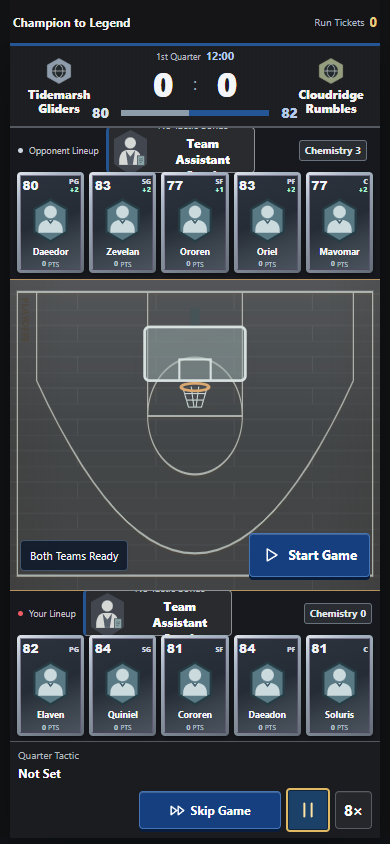

# 从第十到冠军 → 从冠军到传奇

**From Tenth to Champion → Champion to Legend**

个人篮球策略游戏项目。玩家组建阵容，在每节比赛中选择战术，并在征程中通过招募和训练调整球队。我的工作集中在把阵容选择、临场决策和长期成长连成一套可反复游玩的系统。

A personal basketball strategy game about building a lineup, calling a tactic each quarter, and adapting your team across a run. My work focused on connecting roster building, in-game decisions, and long-term progression.

*离线版实机截图，使用虚构球员与原创几何图形。 / Offline game capture with fictional players and original geometric artwork.*

## 我做了什么 / What I built

| 系统 / System | 我解决的问题 / Design problem |
| --- | --- |
| **战术构筑 / Tactical lineup building** | 球员如何改变可用打法，而不只增加评分？ / How can a player change your tactical options, beyond raising a rating? |
| **无尽远征 / Endless progression** | 怎样保留成长带来的优势，同时让后期首领仍有压力？ / How can progression feel rewarding without making late bosses irrelevant? |
| **存档可靠性 / Save reliability** | 遇到断网、重试或多次保存时，怎样保护最新进度？ / How do retries, disconnects, and rapid saves avoid losing progress? |
| **离线与双语 / Offline and bilingual play** | 怎样剥离平台服务，并让中英文共用一份本地进度？ / How can the game drop platform services while sharing saves across languages? |

[设计案例与开发过程 / Design cases and development process](docs/design-notes.md) · [离线首页截图 / Offline home screenshot](screenshots/home.png)

## 单节战术小样 / One-quarter tactics demo

下载本展示仓库后，直接打开 [demo/index.html](demo/index.html)。选择战术，模拟一节，再对比战术加成和比分。相同种子的对照局会重用同一组随机样本，方便比较战术，而不是比较运气。

Download this showcase and open [demo/index.html](demo/index.html) in a browser. Pick a tactic, simulate one quarter, and compare the lineup bonus and score. Replays reuse the same random samples so you can compare choices without changing the luck. No installation, account, or network required.

- [精选代码：单节结算 / Selected code: quarter simulation](demo/quarter.js)
- [精选代码：串行保存 / Selected code: serialized saves](examples/save-queue.js)

这两段是为了说明机制而独立编写的简化示例。截图记录完整游戏的界面；本仓库只包含作品展示和小样。

These are independently written teaching examples with simplified rules. The screenshots document the full game; this repository contains only the showcase and demo.
